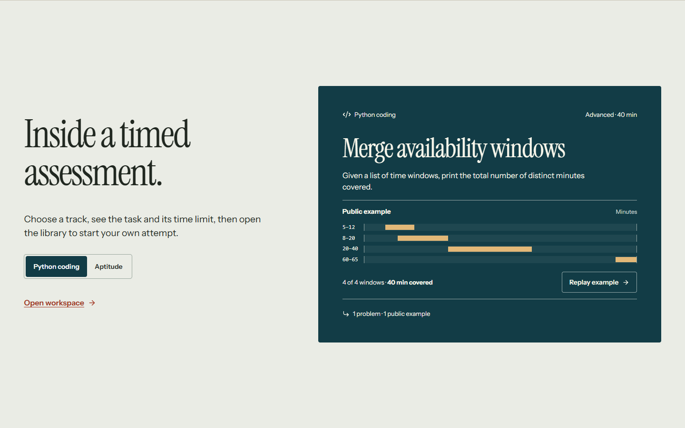
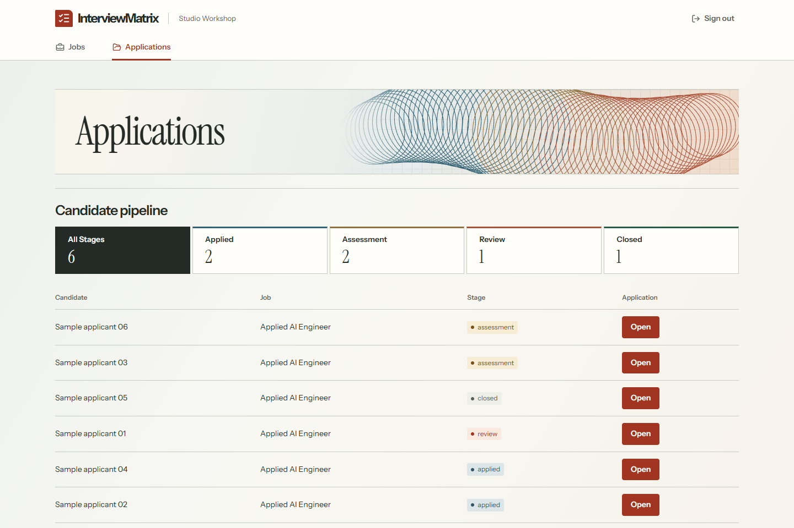

# InterviewMatrix

InterviewMatrix lets candidates practise timed interviews and gives recruiters a way to check the work behind a score. A Python result links to test verdicts, a resume finding links to a source passage, and a hiring decision records the human reviewer’s reasoning.


## Walk through the product

Open the **Review** page and select **Inspect** beside a criterion. The public ledger uses a fictional application so anyone can explore how evidence and gaps are presented. In the authenticated workspace, access follows the application and organization. [Open the local overview](http://127.0.0.1:5173/#home)

### Explore a Python problem

Select **Practice** and trace the public example for *Merge availability windows*. Stepping through four time windows shows why overlapping minutes count once and the total is 40. The preview is interactive without starting a timed attempt.



### Complete an assessment

In a candidate account, choose a company collection, track and level. The problem, example input and expected output sit beside Monaco on desktop and above it on mobile. Python indentation and recoverable drafts help during the timed attempt. The isolated runner executes submitted code. A candidate can then discuss a line of their solution using typed or supported spoken input.


### Review an application

In a recruiter account, filter applications by current stage. Open one to inspect an assessment result and resume evidence against the published job criteria. Accept or override an individual finding and record the reason for the final disposition. The screenshots use synthetic records. [Review walkthrough and release guide](docs/release.md) · [Evaluation architecture](docs/architecture/evaluation-and-readiness.md)



## Run locally on Windows x64

Use Python 3.10+ with venv, Node.js 24.15 or newer in the 24 LTS line with npm, and PowerShell. The first setup needs internet for dependencies and two checksum-verified binaries. Run from the repository root.

```powershell
.\scripts\setup-local.ps1
.\runtime\venv\Scripts\python.exe scripts\local.py
```

Open [the workspace](http://127.0.0.1:5173). Keep the launcher running during the demo. Ctrl+C stops its processes. The local launcher uses loopback HTTP. Register fresh accounts with synthetic information for a presentation.

| Component | Local behavior |
| --- | --- |
| React 19, Vite, Lucide and Monaco | One browser origin proxies API requests. The Python editor and its worker load on demand. |
| FastAPI and SQLite | Transactions, foreign keys and immutable published records. The application database lives in `runtime/matrix.sqlite3`. |
| Dedicated Python execution host | Starts a fresh Wasmtime guest for each public or hidden test. The API and Celery worker never interpret submissions. |
| Private S3-compatible storage | The launcher runs a portable SeaweedFS process backed by `runtime/objects/`. The database stores object keys, checksums, evidence and consent. |
| Celery worker and scheduler | Local mode uses a project-local SQLite message broker. Set `REDIS_URL` to select an existing Redis broker. Beat runs retention and stalled-job recovery. |
| Document scanner and OCR | Windows Defender or an explicitly configured ClamAV daemon scans each file. Native text extraction runs first. Scanned PDF pages need Tesseract with English language data available on PATH. |

The launcher binds to loopback and needs ports 5173, 8000 and SeaweedFS service ports available. Storage credentials are generated at startup. Local logs and downloaded artifacts live under the ignored `runtime/` folder. Storage and queue state survive an ordinary restart. No database server, system service or global npm package is installed by setup.

## Presentation walkthrough

1. **Create a role.** Register a recruiter account and name the organization. In **Jobs → Create job**, enter a description and add criteria such as Python (60%) and problem solving (40%). Publish the version. Use **Assessments** on that role to associate a published test. A later job revision preserves the version used by existing applications.
2. **Invite a candidate.** Add a fictional candidate in the directory and select **Add to pipeline** for the published role. In **Applications**, open the record, choose a published assessment and an expiry, then select **Create private invitation**. Deliver the code privately. The app shows the original token once and stores only its digest. Email delivery is manual.
3. **Complete an assessment.** Open a private browser window and register as a candidate with the invited email. In **Applications**, claim the code, open the attempt and save a draft. Reload and reopen the attempt from history to show recovery. Submit all answers. For coding, write Python that reads stdin and prints stdout. Each question includes one public example. The server reports individual test verdicts and the total. For aptitude, the result also includes section-level feedback where the bank supplies categories.
4. **Review a resume.** With the application open, consent and upload a small PDF or DOCX. For a simple demo, use a fictional document with a “Skills” heading, “Python” on the next line, an “Education” heading and a fictional program. The recruiter can inspect the excerpt, page or document offsets, extraction method and warnings, download the scanned original, and save a correction with a reason.
5. **Make the human decision.** Refresh the recruiter application to see the linked score, move it to review, and inspect the stage history. Compare it with a candidate practice attempt, which is visible only to that candidate. Criteria are stored for review. Stage changes are explicit recruiter actions.

## How scoring works

Published question versions contain the prompt, options or test cases and the authoritative key. A content digest identifies each ordered assessment version. The client receives display fields and posts only question IDs and response values. The server checks ownership, version membership, exact coverage, deadlines and allowed options. Duplicate requests for the same submission return the same result. Modified resubmissions are rejected. Coding retries after runner failure use the original saved source.

Each coding test receives a fresh pinned CPython/WASI image. The host grants stdin and bounded stdout/stderr, with no preopened filesystem or network capability. Each test has a fuel budget, a 96 MiB guest memory ceiling, a 15-second wall deadline and a 16 KiB output limit per stream. At most two run concurrently per API process. Comparisons normalize CRLF and trailing newlines. Stored records link source, question version, runner identity, ordered verdicts and output digests. A grader can recompute a score as passed cases divided by total cases. Programs using randomness or clocks can produce different outputs when rerun.

A remote Judge0-compatible service is an option when assessments need multiple languages or independent execution hosts. This local implementation uses Wasmtime to avoid a Docker or database service installation and keep submissions on the machine. Only the included Python/WASI environment is supported. Optional Gemini coaching sends the candidate’s first submitted solution after an explicit request and consent. Its structured response is separate from every score.

## Practice library

Choose a company, open **Aptitude** or **Python coding**, then start a level. Each level shows its published question count and time limit. Refresh or bookmark a library view to return to it. Opening an attempt requires its owner's session.

The interface ships with company wordmarks and Lucide icons. A local development build can also use the unmodified Python logo at `frontend/my-react-app/src/local-art/python.png`. Git and Docker exclude that folder. A fresh checkout uses the bundled coding icon. [Official Python artwork](https://www.python.org/community/logos/)

## Demo a code follow-up

In **Practice library**, choose a company, open **Python coding**, then start a level. Type `for item in items:`, press Enter, type `if item:` and press Enter again. Monaco places the cursor four spaces deeper for each block by default. The indent-width control also supports two or eight spaces.

Save the draft or choose **Ask about my code**. The discussion cites a line from the saved solution. Answer in the text box or select **Dictate answer**, speak, stop and edit the transcript. **Save explanation** confirms the text. Reopen the attempt to see the response and ask a different question. Each solution supports four questions. Local feedback highlights code names and quotes wording that signals a reason, example or trade-off. It suggests a next step. This wording check cannot establish whether the explanation is technically correct.

The runner grades the submitted Python immediately. Return to **Your attempts → Open** to see the stored score, verdicts and discussion later. On a completed company assignment, the candidate can share an individual question, cited line and confirmed answer with the recruiter or withdraw access. Recruiters open **Applications → Open → Shared coding explanations**. Coaching notes stay private and have no effect on the score. Discussion records have a 90-day retention window. [See a saved explanation and its feedback](docs/images/screening-debrief.webp)

Local practice questions work without a key. For model-generated questions, configure `MATRIX_REVIEW_MODEL` and `MATRIX_REVIEW_KEY` in the backend process and select **Use Gemini** before requesting the question. This sends identifiers, operators and line numbers from selected statements. The question request excludes comments, literals, audio and answers. A separate feedback button sends the confirmed answer, question and code structure to Gemini. The server validates a quoted passage against the saved reply before storing model feedback. The browser may use its own remote speech service after the candidate starts dictation. Microphone dictation needs browser support and HTTPS or localhost. The readiness screen checks live signal and local playback. Typing works independently. [View the readiness screen](docs/images/microphone-readiness.webp) · [Browser speech recognition support](https://developer.mozilla.org/en-US/docs/Web/API/SpeechRecognition)

## Resume evidence and deletion

Uploads accept PDF and DOCX up to 5 MiB. The service checks the MIME, extension, signature or archive structure, limits decompression and pages, and generates a storage key. Duplicate content within one application reuses the document. The Celery task checks the checksum, runs malware scanning and starts a time-limited parser. PyMuPDF extracts native PDF text. python-docx extracts paragraphs and table cells. English Tesseract runs locally on PDF pages with sparse text. The default resume pipeline sends no content to external AI providers.

Text-backed Pydantic records cover contact information, education, work, projects, skills, certifications, achievements and dates. Offsets refer to the extracted text of the page, or the reconstructed DOCX text. Missing sections, incomplete extraction and conflicting dates require review. The section parser preserves the lines it can identify. It cannot reliably interpret unusual layouts, embedded images in DOCX, or all employer and institution names. Manual corrections preserve machine evidence for the current extraction generation. Empty unreadable documents or scanner failures are marked failed. Reprocessing starts a new generation.

The candidate or the owning organization can delete a document. Originals, evidence, corrections and processing records have a 90-day retention target. Reads check expiry immediately. Physical deletion runs on scheduled cleanup and requires storage and the scheduler to be available. Production backup retention needs a separate policy.

## Configuration and operational limits

- Configure optional services using backend process environment variables. `REDIS_URL` selects the broker. `CLAMD_HOST` and `CLAMD_PORT` select a trusted scanner. Independently deployed workers and the API must share `MATRIX_DB`, S3 endpoint, bucket, region and service credentials. Set `MATRIX_HOSTS` to the comma-separated list of trusted API hostnames for a deployment. Use TLS and private networking for remote dependencies.
- Gemini code coaching requires an explicitly configured `MATRIX_REVIEW_MODEL` and freshly issued `MATRIX_REVIEW_KEY`. Credentials in old environment files are never loaded by the application. Keep secrets out of `VITE_*` and Git.
- The launcher is a trusted single-user, loopback demo. Application roles isolate tenants in the API. The OS account can access the SQLite database, object files and loopback storage administration. Use synthetic information locally. Before public deployment, isolate the runner and parser on dedicated low-privilege hosts, provide TLS, private object storage, encryption at rest, backups, quotas, identity verification and managed secrets. Exercise Redis and recovery under load.
- The checked-in practice bank is public, including expected outputs. For a confidential hiring assessment, author and provision separate private versions. The bundled historical company names describe the practice library.
- Historic credentials require provider-side revocation or rotation and incident review. A clean working tree does not revoke a leaked credential or purge old clones. Follow the existing [security assessment](docs/security/security-assessment.md) and [repository safeguards](docs/git-safety.md).
- The [architecture proposal](docs/architecture/system-architecture.md) documents the original design. The local edition uses SQLite. The container edition uses PostgreSQL and Redis. Advanced resume AI and automated hiring decisions are outside this release.

## Verification

```powershell
.\runtime\venv\Scripts\python.exe -m pip install -r backend/requirements-test.txt
.\runtime\venv\Scripts\python.exe -m pytest tests -q
npm --prefix frontend/my-react-app test
# First install the Playwright Chromium test browser in the frontend directory,
# or set MATRIX_BROWSER_CHANNEL=chrome to use an existing Chrome installation.
npm --prefix frontend/my-react-app run test:e2e
npm --prefix frontend/my-react-app run lint
npm --prefix frontend/my-react-app run build
npm run test:repo-safety
npm run check:repo
```

The suite constructs fictional applications and documents in temporary databases. Coding tests execute the real guest. Repeatable upload tests use a simulated S3 endpoint, scanner and synchronous task delivery, while exercising the real document parser. The scanned-image integration test requires Tesseract. API descriptions are available in [local OpenAPI](http://127.0.0.1:8000/docs).
