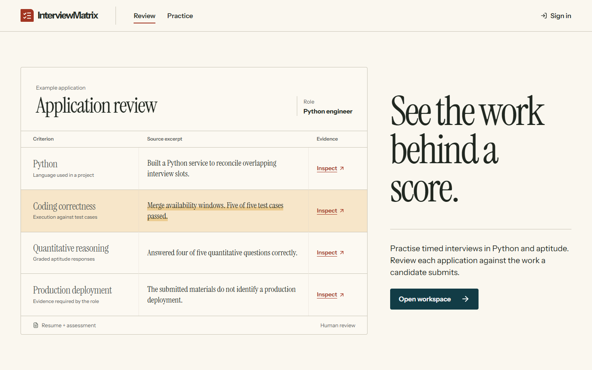
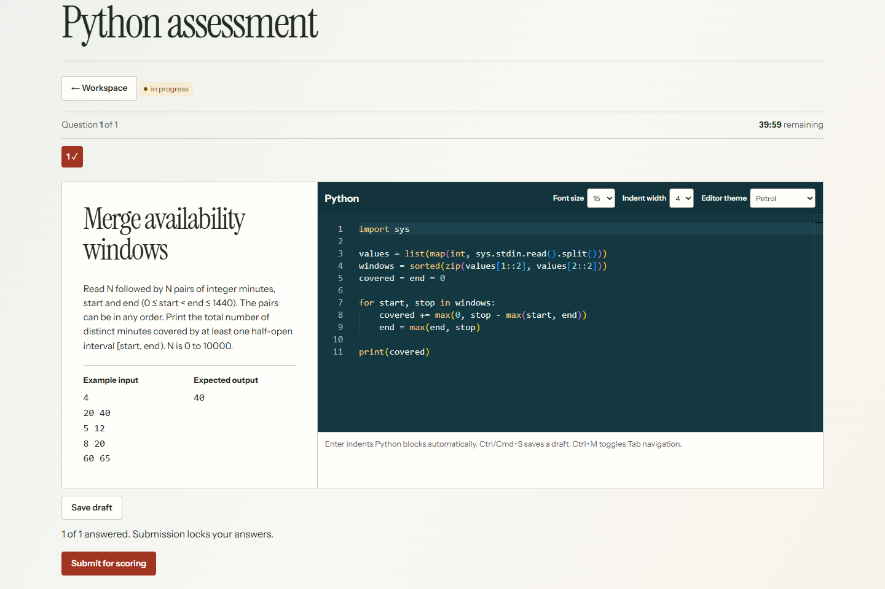
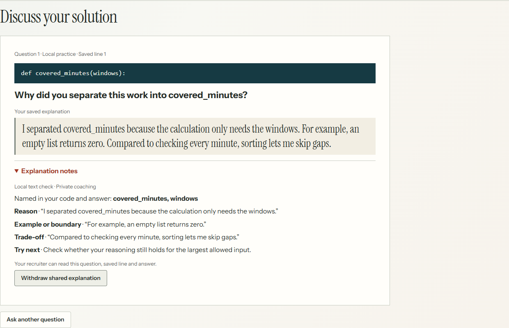

# InterviewMatrix

**The code passed. Why does it work?**

InterviewMatrix is a screening workspace for candidates and recruiters. A candidate solves a timed problem, then talks through a line of their own Python. A recruiter can follow the test verdict back to the submitted work, inspect the evidence for a job criterion, and record a hiring decision.



## Walk through the product

**Start with two overlapping meetings.** The Python practice problem *Merge availability windows* asks how many minutes are covered. Counting both meetings in full counts their overlap twice. In the public preview, you can step through four windows and see why the answer is 40. [Explore the interval trace](docs/images/python-trace.webp)

In **Practice library**, choose a company, then **Aptitude** or **Python coding**, then a level. Each edition shows its question count and time budget before the clock starts. In the editor, pressing Enter after `for` or `if` puts the cursor inside the block. Save the draft and you can reopen it during the attempt.



### Demo a code follow-up

> Why did you separate this work into covered_minutes?

That question refers to a function in the saved solution below. Select **Dictate answer** or type a reply, edit the text, then select **Save explanation**. Local feedback quotes the candidate’s reasoning and suggests what to explain next. Optional Gemini feedback requires a separate sharing choice. The browser’s dictation service may process audio remotely. [Microphone readiness and local playback](docs/images/microphone-readiness.webp)



**Come back after submission.** Each public and hidden test runs in a fresh, resource-limited Python/WASI guest. **Your attempts → Open** brings back the score, individual verdicts and discussion. Coaching has no weight in the score. For a completed company assignment, the candidate chooses which explanations the recruiter can read and can withdraw access later. [View a graded Python attempt](docs/images/assessment-result.webp)

### At the recruiter’s desk

Publish a job with weighted criteria, invite a candidate to an assessment, then open their application. A Python result has test verdicts. A resume finding has a source passage. A reviewer can inspect either, override a finding with a reason and record the decision. The screenshots use fictional applications. [Recruiter walkthrough](docs/release.md#local-setup-and-walkthrough)


## Run locally on Windows x64

From the repository root, use PowerShell, Python 3.10+ and Node.js 24 LTS (24.15 or newer). First setup downloads dependencies. SQLite, private object storage and queue data stay under the ignored `runtime/` directory.

```powershell
.\scripts\setup-local.ps1
.\runtime\venv\Scripts\python.exe scripts\local.py
```

Open the workspace and register with an email and password. For the two-sided walkthrough, use fictional recruiter and candidate accounts in separate browser sessions. Leave the launcher running and press Ctrl+C to stop it. [Local workspace](http://127.0.0.1:5173) · [Local API reference](http://127.0.0.1:8000/docs)

### Saved test login

With the local app running, use either command from the repository root. The launcher opens sign-in with the email filled and copies the password. Paste it and select **Sign in**. Omit `-Browser Brave` to use your default browser.

```powershell
.\scripts\demo-login.ps1 -Browser Brave
.\scripts\demo-login.ps1 -Role Recruiter -Browser Brave
```

Each role gets a synthetic account with a random password saved under `runtime/demo-login/`, encrypted for the current Windows user. Browsers pointed at the same local instance share these accounts and keep separate sessions. Use fictional data in these workspaces.

<details>
<summary><strong>Engineering notes and verification commands</strong></summary>

- **Assessment integrity.** FastAPI binds each attempt to a published version and enforces its deadline. The isolated Wasmtime runner executes submitted Python with bounded memory, output and time, and no network access.
- **Resume evidence.** Celery scans and parses private PDF and DOCX uploads. Scanned PDFs need local Tesseract. Extracted facts retain their source references for review. [Evaluation architecture](docs/architecture/evaluation-and-readiness.md)
- **Operating scope.** The local edition is for a controlled demonstration. The practice bank is public. Live hiring requires private assessment content, verified identities, hardened execution infrastructure and confirmation that historical credentials were rotated. [Release gates](docs/release.md#security-and-release-gates) · [Security assessment](docs/security/security-assessment.md)

After local setup, run the checks below. For the browser tests, install Playwright Chromium in the frontend directory or set `MATRIX_BROWSER_CHANNEL=chrome` to use an existing Chrome installation.

```powershell
.\runtime\venv\Scripts\python.exe -m pip install -r backend/requirements-test.txt
.\runtime\venv\Scripts\python.exe -m pytest tests -q
npm --prefix frontend/my-react-app test
npm --prefix frontend/my-react-app run test:e2e
npm --prefix frontend/my-react-app run lint
npm --prefix frontend/my-react-app run build
npm run test:repo-safety
npm run check:repo
```

</details>
