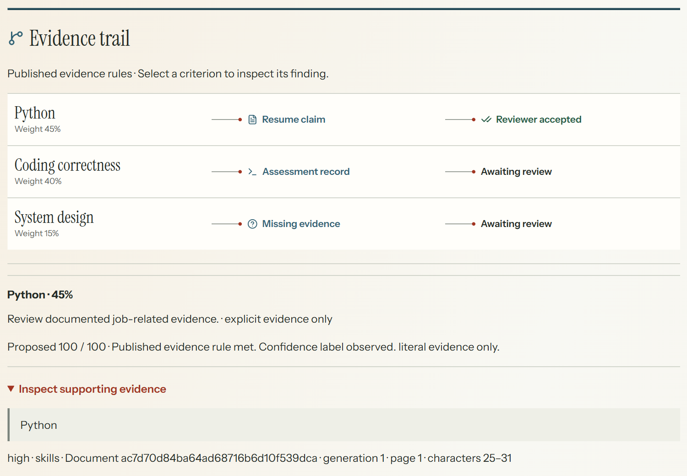
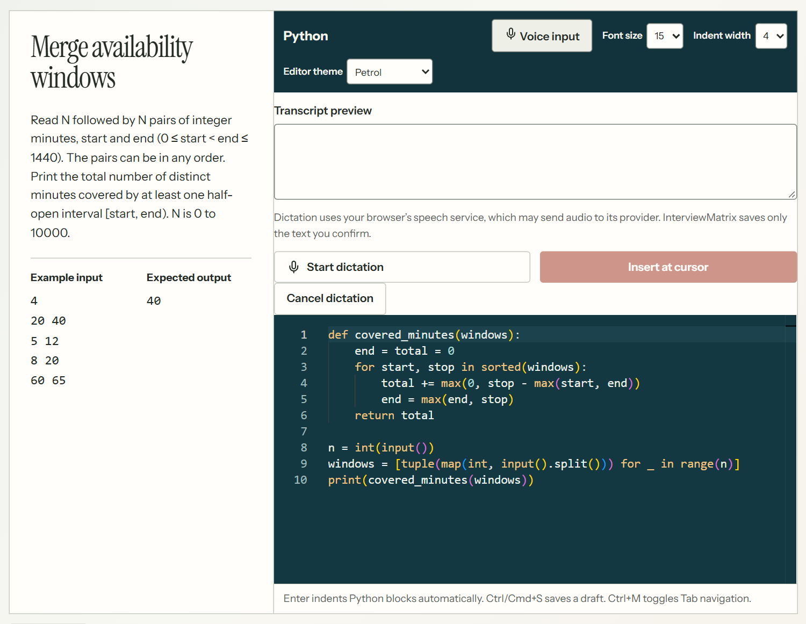
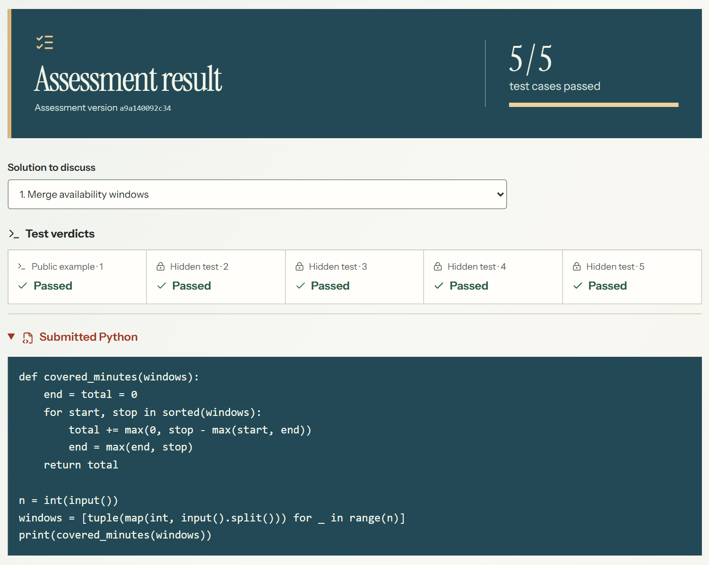
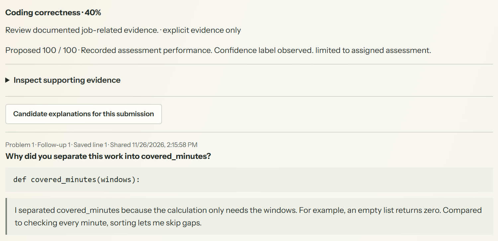
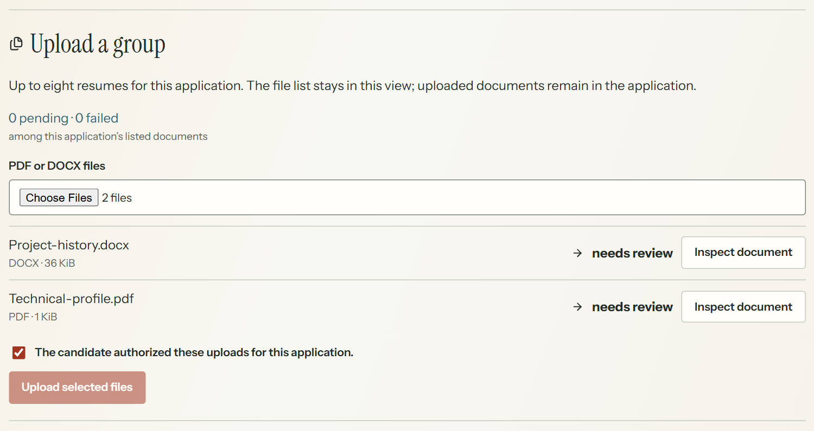
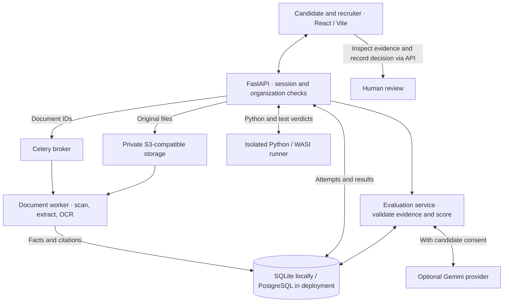

# InterviewMatrix

**“Python” on page one. Five passing tests. Two different pieces of evidence.**

I first built InterviewMatrix in my third year. After a technical interview, I came back to it with one question: if I were the reviewer, could I explain exactly where a score came from?

This fictional application shows how the answer changes with the source. On page 1 of the resume, characters 25–31 spell *Python* under Skills. An exact-match rule proposed 100/100 for that criterion, and the reviewer accepted it. The resume makes no claim about system design, so that criterion stays unscored. To see what the candidate can do with Python, open the submitted program.



## At the keyboard

Four availability windows arrive out of order. Their lengths add up to 44 minutes, but some overlap. The candidate’s job is to count each minute once. [Step through the example](docs/images/python-trace.webp)

In **Practice library**, choose a company, track and level to see the time budget before starting. The Python editor indents nested blocks on Enter and saves drafts on request. Voice input opens an editable transcript. The candidate chooses when to insert it, and one Undo removes the insertion. Browser dictation may send audio to the browser’s speech provider. [Microphone readiness and playback](docs/images/microphone-readiness.webp)



The submitted solution sorts the windows and counts only newly covered minutes. For the public example it returns **40**. One public case and four hidden cases passed in isolated Python execution. Reopening the attempt brings back the submitted code and its individual verdicts.



## After the clock stops

> Why did you separate this work into covered_minutes?

That follow-up points to a function the candidate actually wrote. They can type or dictate an explanation, edit it, then save it. Coaching is separate from correctness. In a completed company assignment, the candidate can share an individual answer with the recruiter and later withdraw access. [Candidate explanation and coaching notes](docs/images/screening-debrief.webp)



## Back at the recruiter’s desk

A recruiter can publish weighted criteria, invite a candidate to an assessment, inspect the evidence and record a review. For resume intake, **Upload a group** accepts up to eight PDFs or DOCX files for the open application, with consent. Each file has its own processing state and retry. Uploaded documents persist when the browser selection clears.

In this walkthrough, a PDF and a DOCX both finished extraction with warnings. Both show **needs review**. Selecting either opens that document for inspection. Scanned PDFs use OCR when native extraction is insufficient. [Reproduce the walkthrough](docs/release.md#local-setup-and-walkthrough)



## Inside the application

FastAPI binds an attempt to its published questions and deadline. The runner produces test verdicts, the document worker produces cited facts, and the evaluation service checks those sources against the job rubric. A recruiter records the human review.



## Run locally on Windows x64

From the repository root, use PowerShell, Python 3.10+ and Node.js 24 LTS (24.15 or newer). First setup downloads dependencies. SQLite, private object storage and queue data stay under the ignored `runtime/` directory.

```powershell
.\scripts\setup-local.ps1
.\runtime\venv\Scripts\python.exe scripts\local.py
```

Open the workspace and register with an email and password. For the two-sided walkthrough, use fictional recruiter and candidate accounts in separate browser sessions. Leave the launcher running and press Ctrl+C to stop it. [Local workspace](http://127.0.0.1:5173) · [Local API reference](http://127.0.0.1:8000/docs)

### Saved test login

With the local app running, use either command from the repository root. The launcher opens sign-in with the email filled and copies the password. Paste it and select **Sign in**. Omit `-Browser Brave` to use your default browser.

```powershell
.\scripts\demo-login.ps1 -Browser Brave
.\scripts\demo-login.ps1 -Role Recruiter -Browser Brave
```

Each role gets a synthetic account with a random password saved under `runtime/demo-login/`, encrypted for the current Windows user. Browsers pointed at the same local instance share these accounts and keep separate sessions. Use fictional data in these workspaces.

<details>
<summary><strong>Engineering notes and verification commands</strong></summary>

- **Assessment integrity.** FastAPI binds each attempt to a published version and enforces its deadline. The isolated Wasmtime runner executes submitted Python with bounded memory, output and time, and no network access.
- **Resume evidence.** Celery scans and parses private PDF and DOCX uploads. Scanned PDFs need local Tesseract. Extracted facts retain their source references for review. [Evaluation architecture](docs/architecture/evaluation-and-readiness.md)
- **Operating scope.** The local edition is for a controlled demonstration. The practice bank is public. Live hiring requires private assessment content, verified identities, hardened execution infrastructure and confirmation that historical credentials were rotated. [Release gates](docs/release.md#security-and-release-gates) · [Security assessment](docs/security/security-assessment.md)

After local setup, run the checks below. For the browser tests, install Playwright Chromium in the frontend directory or set `MATRIX_BROWSER_CHANNEL=chrome` to use an existing Chrome installation.

```powershell
.\runtime\venv\Scripts\python.exe -m pip install -r backend/requirements-test.txt
.\runtime\venv\Scripts\python.exe -m pytest tests -q
npm --prefix frontend/my-react-app test
npm --prefix frontend/my-react-app run test:e2e
npm --prefix frontend/my-react-app run lint
npm --prefix frontend/my-react-app run build
npm run test:repo-safety
npm run check:repo
```

</details>
