# AI evaluation architecture

Status: proposed. AI is an advisory evaluation component, never the authority
for hiring decisions.

## Provider abstraction

Application services depend on an evaluator interface rather than Gemini:

```python
class EvaluationProvider(Protocol):
    async def evaluate_resume(self, request: ResumeEvaluationRequest) -> ResumeEvaluationResult: ...
    async def review_code(self, request: CodeReviewRequest) -> CodeReviewResult: ...
```

The Gemini adapter owns provider-specific SDK calls, model names, retryable
errors, token accounting, and response parsing. A future provider can be added
without changing job, assessment, or review modules.

## Structured contracts

Every model response must validate against a versioned Pydantic contract.

```text
EvaluationRun
  request_schema_version
  prompt_template_version
  provider
  model
  status
  input_hash
  output_hash
  token_usage
  latency_ms

CriterionScore
  criterion_id
  score
  confidence
  decision: supported | missing | conflicting | unclear
  evidence[]
  limitations[]
```

Invalid output is a failed evaluation, not a successful evaluation containing
free-form fallback text. A bounded repair attempt may be made; repeated failure
must enter a human-review queue.

## Resume evaluation pipeline

```mermaid
flowchart LR
  Upload[Private resume upload] --> Scan[Content and malware scan]
  Scan --> Extract[Text and layout extraction]
  Extract --> Facts[Structured candidate facts]
  Facts --> Criteria[Published job criteria version]
  Criteria --> Prompt[Versioned evaluation request]
  Prompt --> Provider[Provider abstraction]
  Provider --> Validate[Pydantic validation]
  Validate --> Evidence[Scores and evidence spans]
  Evidence --> Review[Recruiter review and override]
  Review --> Audit[Immutable audit event]
```



The extractor and evaluator are separate jobs. This makes failures diagnosable,
allows evidence to be reviewed before scoring, and avoids asking a model to
perform extraction, judgment, and explanation in one opaque call.

## Code review pipeline

1. Candidate submits an attempt answer.
2. The server verifies attempt ownership and question version.
3. The execution service runs the code against immutable tests.
4. The evaluation worker receives execution facts, not arbitrary hidden system
   prompts.
5. The provider returns a schema-validated review containing correctness,
   quality, complexity, edge cases, and evidence.
6. The result is stored with model, rubric, prompt, and execution metadata.
7. A reviewer can override or annotate the result.

AI should never be the only correctness signal for code. Deterministic test
execution is authoritative for pass/fail; AI explains quality and likely issues.

## Prompt safety

- Delimit candidate content as untrusted data.
- Tell the model to treat resume text and code as data, not instructions.
- Do not place secrets or internal policy text in candidate-visible prompts.
- Limit input and output tokens.
- Strip or reject executable HTML from output.
- Store raw output only in restricted audit storage when policy permits.
- Return a generic failure to clients and log provider details securely.

## Reliability and cost controls

- Celery retries only transient provider failures.
- Exponential backoff and a maximum retry count are required.
- Each evaluation has a deadline and cancellation state.
- Per-organization and per-job budgets are enforced before enqueueing.
- Token usage and latency are recorded.
- Duplicate requests use an idempotency key and input hash.
- Provider outages degrade to queued or human review, not fabricated scores.

## Evaluation quality

Before using AI output in recruiter workflows, create a labeled evaluation set:

- Representative resumes and code submissions.
- Expected criterion decisions.
- Evidence quality labels.
- Human reviewer agreement.
- False-positive and false-negative review.
- Stability across prompt and model versions.

Track accuracy, evidence precision, unsupported-claim rate, abstention rate,
latency, and cost. A model version cannot become the default without a reviewed
comparison against the current version.

## RAG and orchestration decision

Use ordinary database queries for recruiter-defined criteria. Add RAG only when
the platform maintains a meaningful corpus of role rubrics or policy documents
that evaluators must cite. Use LangGraph only if an evaluation requires durable,
human-interruptible multi-step state, such as extraction → evidence review →
reconciliation → reviewer escalation. Ordinary Celery jobs and application
services are clearer for the initial pipeline.
