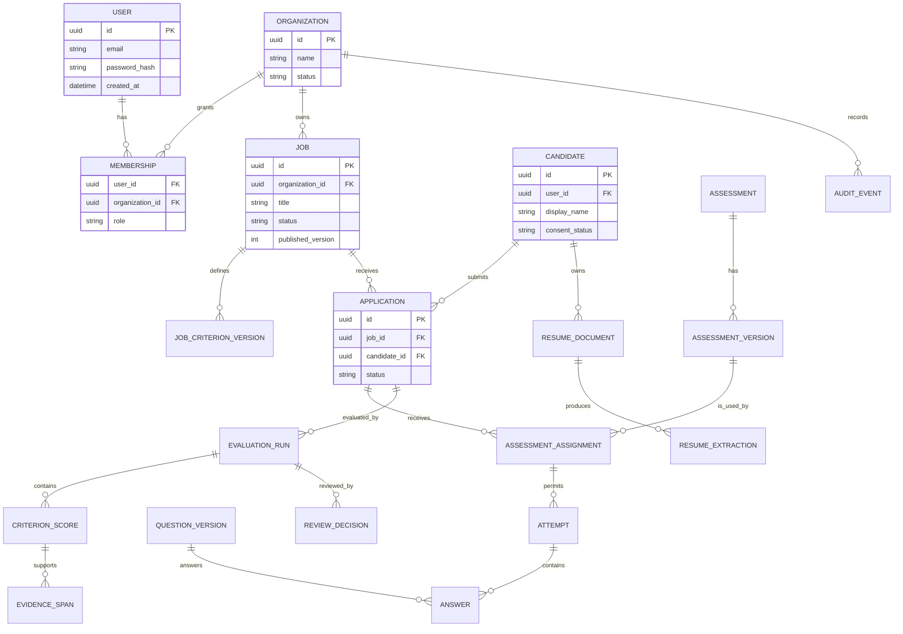

# InterviewMatrix AI domain model

Status: proposed. The current JSON files are migration input, not the target
domain model.

## Tenant and identity model

An organization is the security boundary for recruiter data. A user may belong
to multiple organizations with different memberships. A candidate may exist as
a platform user or as an invited applicant without a full account.



## Assessment model

An assessment template is immutable after publication. Editing creates a new
assessment version. An assignment points to exactly one published version.
Attempts snapshot the version and selected question IDs so later question edits
cannot change historical results.

```text
Assessment
  └─ AssessmentVersion
       ├─ AssessmentSection
       │    └─ QuestionVersion
       └─ timing / attempt limits / scoring policy

Assignment
  └─ Attempt
       ├─ Answer
       ├─ CodeSubmission
       ├─ ExecutionRun
       └─ AttemptEvent
```

Required invariants:

- An attempt belongs to one candidate and one organization.
- An attempt references an immutable assessment version.
- The server selects and scores questions.
- A finalized attempt cannot accept another answer.
- A retry creates a new attempt, never mutates a finalized result.
- Scores are derived from stored answers and rubric versions.

## Resume and explainable evaluation model

Resume ingestion is a pipeline, not a single AI call:

```text
ResumeDocument
  → malware/content scan
  → text extraction
  → ResumeExtraction
  → normalized CandidateFacts
  → EvaluationRun against CriterionVersion
  → CriterionScore + EvidenceSpan
  → ReviewDecision
```

`EvidenceSpan` should store the source document ID, page or section where
possible, character offsets when stable, quoted text, and a confidence value.
Scores must distinguish:

- Supported evidence.
- Contradictory evidence.
- Missing evidence.
- Unclear or low-confidence evidence.

AI recommendations remain advisory. A recruiter decision is a separate event
with an actor, timestamp, reason, and criteria version.

## Privacy and lifecycle fields

Sensitive entities need explicit lifecycle metadata:

```text
created_at
updated_at
deleted_at (nullable)
retention_until (nullable)
consent_version (nullable)
source_system (nullable)
```

Resume objects and interview recordings require encryption, private access,
checksums, retention policies, and deletion workflows. The database stores
metadata and derived facts separately from raw documents.

## Tenant isolation rules

- Every recruiter query starts from the authenticated organization context.
- Object keys include organization and document IDs.
- Repository methods require organization ID for organization-owned records.
- Cross-tenant IDs return the same not-found response as unknown IDs.
- Background jobs carry tenant context and re-check ownership before writing.
- Analytics read models are partitioned or filtered by organization.
- Audit events record the organization, actor, target, and action.
