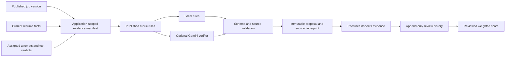

# Evaluation, review and interview readiness

A scorecard belongs to one application and the immutable job version selected when it was created. Generating or finalizing a scorecard leaves the candidate’s application stage untouched.

## Boundaries and evidence

| Responsibility | Implementation |
| --- | --- |
| Read the job, resumes and assessments | `evaluation_context.py` scopes the application before all three lookups. It includes the latest completed **assigned** attempt of each type. Private practice results stay outside evaluation. |
| Construct evidence | Resume references bind the document, generation, section, page, offsets and excerpt. Assessment references bind the attempt and immutable version. Coding citations can include test verdicts and versions of the execution engine. |
| Propose a finding | `evaluation_provider.py` supports local evidence rules and Gemini verification. `gemini.py` owns the bounded structured transport. |
| Check the finding | `evaluation_contracts.py` validates the full criterion set, score range, exact evidence ID and page, allowed explanations, limitations and flags. An unsupported claim invalidates the response. |
| Persist and review | `evaluation_service.py` checks the source fingerprint again after inference. It stores validated proposals and serializes each revision of the human review. The FastAPI router handles request and response boundaries. |

Each criterion carries a name, description, weight, source type, required evidence, maximum integer score and instruction policy. Criteria are identified by position within the immutable job version. Weights sum to 100. Editing a published rubric creates a job revision. Historical two-field criteria use a 100-point explicit skills rule with the original name as the required entry.

Resume rules cover skills, employment, projects and education. An exact, explicitly extracted requirement supports the published literal-match rule. A phrase inside a longer entry supplies a citation for human interpretation. Missing facts remain unscored. OCR uncertainty, corrected fields, duplicate references and human-confirmation instructions restrict automated scoring. One cited item can carry weight only once in a review. Known sensitive criterion names are rejected. The vocabulary check is limited and recruiters remain responsible for job relevance.

Aptitude and coding rules scale the recorded number of passes to the criterion maximum. A separate qualitative code rule can cite a documented Python function and its line number. Static syntax inspection never runs the code. This check establishes the presence of documentation. A recruiter must judge its usefulness.

`Finding` carries `criterion_id`, nullable `score`, a categorical `confidence`, citations, a constrained explanation, missing-evidence status, limitations and review flags. The UI resolves the citation against authorized current sources. If evidence changes, the proposal is marked stale and further review requires regeneration. The record expires by 90 days or the earliest cited document expiry. Deleting a resume also removes the application’s scorecards and their review histories.

Python calculates the normalized weighted mean of criterion percentages using rational arithmetic. An incomplete scope has a null aggregate and displays covered weight. Reference and reviewer aggregates remain separate. Accepting a criterion or overriding it records the actor, time, criterion, previous value, replacement value and reason. The original proposal remains visible. A revision precondition rejects simultaneous stale edits. **Complete review** and **Request information** are human dispositions. Neither moves a stage or ranks applicants.

## Model and quality boundaries

The prompt version is `rubric-verify-v1`. Gemini receives an enumerated evidence type, verified counts or match indicators, quality, the score scale, and allowed supported or abstaining findings. Opaque references and page pointers let the backend check the response. Candidate names, personal contacts, raw resume text, raw code and recruiter free text are excluded. Candidate permission is required per application and can be withdrawn. Independent practice coaching sends source only after its own explicit consent.

The model can abstain where a rule permits a score. It cannot invent a different score or citing page. The transport uses a ten-second request timeout, at most three attempts, backoff for transient errors, bounded input structure, an 8,192-token evaluation output cap and a bounded response body. A blocked, truncated, unavailable or invalid response produces an error and no scorecard. Each call records a correlation ID, status, latency and available usage. Estimated cost requires configured input and output prices. Unavailable usage and prices cannot substantiate billing totals. See [Gemini structured output documentation](https://ai.google.dev/gemini-api/docs/structured-output).

Golden tests assert the expected source pointers, missing values and weighted arithmetic. Negative cases cover invented criteria, pages, sources and scores, extra decision fields, prompt instructions and duplicate criteria. A synthetic resume containing an instruction verifies that candidate text cannot reach the evaluation prompt. These are contract and regression measurements. There is no labelled recruiter dataset for estimating human agreement, predictive validity, demographic fairness or calibrated confidence.

## Browser behavior

The Python editor uses Monaco’s Python tokens, Enter rules, native selection, undo stack and paste handling. A candidate can select a theme, font size and indent width. Ctrl/Cmd+S saves a server draft. Tab recovery is scoped to the attempt and version in session storage. Explicit sign-out clears cached drafts. Successful submission locks server answers. Browser recovery is best effort if storage is disabled. The server still owns the deadline and grade.

The Readiness screen requests audio after a user gesture. It distinguishes API support, permission, a sustained signal, completed local playback and the user’s confirmation. Device changes invalidate earlier verification. Switching devices, stopping or leaving the screen stops tracks, closes the audio context and revokes blob URLs. Recording is limited to four seconds in tab memory. The level meter has a text status, native controls carry labels, and the editor offers a high-contrast theme and keyboard navigation. The implementation includes no camera capture, transcription or emotion inference.

Browser QA used Chromium, an actual Monaco instance and browser audio/recording APIs with a generated tone. Firefox, Safari, mobile devices, physical microphones and assistive-technology combinations need a manual pass. A secure context is required for microphone access. See [the browser media-permission reference](https://developer.mozilla.org/en-US/docs/Web/API/MediaDevices/getUserMedia).

## Question-level code discussions

The candidate can request a follow-up during an open coding attempt or after submission. The API resolves candidate ownership, version membership and the server-saved solution. Python tokenization extracts statement anchors without interpreting candidate code. The local generator chooses a line and asks about intent, edge cases or alternatives. The optional Gemini prompt (Python interview follow-up v1) sends a bounded list of tokenized anchors with explicit consent. The server checks the returned schema and line membership. An invalid response leaves the question unanswered and the local generator available. These checks establish line provenance. They do not guarantee the educational quality of model prose.

`GET/POST /api/v1/attempts/{attempt}/questions/{question}/follow-ups` reads or creates the next question. A candidate confirms one text response using `PUT .../follow-ups/{turn}`. The attempt, question version, ordinal, captured line, source digest, provider and timestamps bind the conversation to the code revision. Retries reuse existing turns and answers. The assessment score and recruiter evaluation exclude these private conversations. Discussion access ends 90 days after the attempt starts and scheduled retention removes the rows.

Dictation uses the browser’s speech recognizer after a user gesture. Interim words stay in the UI, final words enter the editable text box, and saving sends only confirmed text to the application. Leaving the question aborts dictation. The browser may process audio externally and permission or service failures leave typing available. The microphone preflight remains a separate local recording and playback flow.
