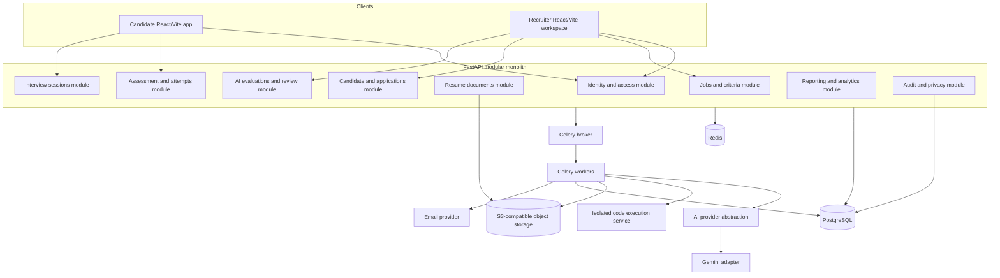
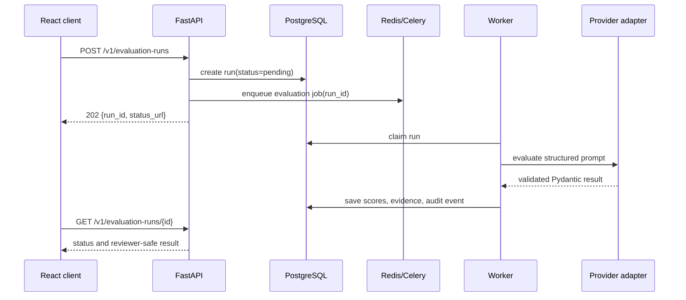

# InterviewMatrix AI system architecture

This document records the original assessment. The [controlled demo release guide](../release.md) describes the implemented services and current verification gates.

Status: proposed architecture for Phase 0. This document describes a target
modular monolith; it does not claim that the current application already has
these capabilities.

## Goals

- Serve candidate practice and recruiter-managed hiring workflows from one
  coherent product.
- Keep the first production system deployable as one FastAPI application plus
  workers, while preserving module boundaries that can later be extracted.
- Make assessment results, AI evaluations, resume evidence, and human decisions
  traceable and reproducible.
- Keep untrusted resumes, candidate code, and model output isolated from the
  web process and from one another.
- Preserve a simple candidate experience while giving recruiters controlled,
  explainable review tools.

## Deliberate scope

This is a modular monolith, not a microservice fleet. FastAPI owns the HTTP API
and domain orchestration. Celery workers handle slow or retryable jobs. PostgreSQL
is the system of record. Redis provides broker/result coordination and short-lived
cache data. S3-compatible storage holds resumes and interview artifacts. A separate
code-execution service is the trust boundary for arbitrary candidate programs.

RAG, LangChain, and LangGraph are optional. They should be introduced only when
the product has a maintained corpus or a real multi-step stateful workflow that
cannot be expressed clearly with ordinary application services.

## Logical architecture



## Module boundaries

| Module | Owns | Does not own |
|---|---|---|
| Identity and access | users, sessions, organizations, memberships, roles | candidate scoring |
| Jobs and criteria | job definitions, criterion versions, publication | raw resume parsing |
| Candidates and applications | candidate identity, consent, job applications | authentication credentials |
| Assessments | question versions, assessment templates, attempts, answers | AI provider details |
| Interviews | interview sessions, readiness checks, recordings metadata | code sandbox internals |
| Resumes | document metadata, object references, extraction status | hiring decisions |
| Evaluations | rubric runs, criterion scores, evidence, reviewer decisions | user passwords |
| Analytics | read models and aggregate queries | mutable source-of-truth writes |
| Audit and privacy | audit events, retention, consent, deletion workflows | business scoring rules |

Each module exposes application services and typed DTOs. Route handlers should
validate transport input, authorize the request, call one application service,
and map the result to a response model. Routes should not write directly to
PostgreSQL or object storage.

## Request and job boundaries

Synchronous API work should be limited to authentication, reads, draft edits,
attempt creation, answer submission, and lightweight state transitions. The API
returns a job ID for resume extraction, AI evaluation, report generation, and
email delivery.



## API boundary

The API should be versioned from the first production migration:

```text
/api/v1/auth/*
/api/v1/organizations/*
/api/v1/jobs/*
/api/v1/candidates/*
/api/v1/applications/*
/api/v1/assessments/*
/api/v1/attempts/*
/api/v1/interviews/*
/api/v1/resumes/*
/api/v1/evaluation-runs/*
/api/v1/reviews/*
/api/v1/analytics/*
```

Every resource carries an organization boundary where applicable. IDs are
opaque UUIDs. List endpoints are paginated. Mutating endpoints accept an
idempotency key where retries could create duplicate attempts, jobs, invitations,
or evaluations.

## Technology decisions

### React/Vite and Material UI

Retain React/Vite and Material UI. Add a feature-oriented frontend structure,
route guards, typed API clients, query caching, and a safe markdown renderer.
Monaco is justified for the coding assessment because syntax-aware editing,
Python indentation, undo/redo, and editor diagnostics cannot be implemented
reliably with a multiline text field.

### FastAPI and SQLAlchemy 2

Retain FastAPI. Use SQLAlchemy 2 typed models and explicit repositories or
query services. Keep business rules in application/domain services rather than
route functions. Pydantic models should exist separately for commands,
responses, and AI contracts.

### PostgreSQL and Alembic

PostgreSQL is justified by relational ownership, transactional attempt scoring,
tenant boundaries, recruiter queries, and audit history. Alembic is required
for reproducible schema changes. JSONB can hold provider-specific raw outputs,
but canonical scores and evidence require relational columns.

### Redis and Celery

Redis plus Celery is justified for resume extraction, AI evaluation, report
generation, notifications, and retryable work. It is unnecessary for ordinary
reads or simple candidate navigation. Jobs must be idempotent, bounded, and
observable.

### S3-compatible storage

Resumes, recordings, and large artifacts should not live in PostgreSQL or the
web container. Store object metadata and a checksum in PostgreSQL. Use private
objects and short-lived signed URLs. Virus scanning and content-type validation
must happen before parsing.

### Isolated code execution

The API must never execute candidate code. A runner service should receive a
short-lived job containing an immutable test bundle, run in a restricted
sandbox, and return bounded stdout, stderr, exit status, timing, and resource
usage. The runner has no application database credentials and no unrestricted
network access.

### Testing strategy

Pytest is the backend contract and integration test framework. It should cover
authorization, tenant isolation, assessment invariants, migration fixtures,
provider failure handling, upload policy, and job idempotency. Vitest is the
frontend unit/component framework. It should cover route guards, assessment
state transitions, safe feedback rendering, readiness checks, and API error
states. Browser-level flows may be added later with a dedicated browser runner;
they are not a reason to introduce a second frontend unit-test framework.

The repository currently has no product test suite. Existing repository-safety
tests are guard tooling and should remain separate from application behavior
tests.

## Non-goals for this phase

- No automatic hiring or rejection decisions.
- No facial, emotion, or personality inference.
- No microservice split before module ownership and operational load justify it.
- No vector database until a maintained retrieval corpus exists.
- No LangGraph workflow merely for technology branding.
